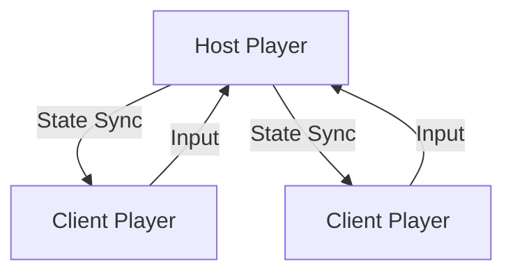
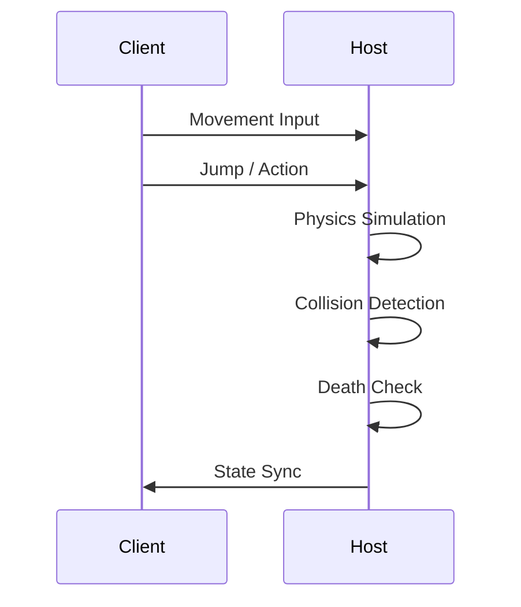

<h1>
  
Wemble Guys
</h1>

> A fast-paced **browser-based 3D multiplayer party game** inspired by Fall Guys–style arenas, built with **React + R3F/Three.js/WebGL** and **Rapier physics**, using **Playroomkit host-authoritative P2P** for input/state sync.

Wemble Guys is a real-time, physics-driven multiplayer playground where clients send inputs to a host that simulates movement, collisions, and death, then broadcasts transforms and animation state to peers. The arena is a multi-floor hex grid with RPC-synced tile destruction.

---

## 📸 Preview / Thumbnail


---

## Badges


[](./LICENSE)

---

## 🧠 What This Project Is

- 🎮 Real-time multiplayer 3D game (host-authoritative P2P)
- 🌐 Runs fully in the browser (WebGL via Three.js + R3F)
- 🔗 Peer-to-peer networking (Playroomkit state + RPC)
- 🧱 Physics-based gameplay (Rapier rigid bodies + colliders)
- 🕹 Keyboard + joystick support (KeyboardControls + Playroomkit Joystick)
- 🎨 Animated GLTF characters with name tags (GLTF animations + Text labels)

### Designed as:

- A WebGL / R3F reference project (asset compression + loaders)
- A multiplayer architecture experiment (host-authoritative state sync)
- A gameplay prototype for collapse-tile survival

---

## 🛠 Tech Stack

### Core

- React 19
- TypeScript
- Vite (SWC)
- Three.js
- @react-three/fiber (R3F renderer)
- @react-three/drei (controls, text, loaders)
- @react-three/postprocessing

### Physics

- Rapier Physics (rigid bodies + colliders)
- @react-three/rapier

### Multiplayer

- playroomkit
- Host-authoritative P2P rooms
- Multiplayer state + RPC (pos/rot/animation, tile hits)
- Player profiles & inputs

### Assets & Styling

- Tailwind CSS
- GLTF / GLB models (Draco + Meshopt compressed)
- Draco + Meshopt decoders served from `public/draco/`
- HDR environment lighting
- MP3 sound effects & background audio

---

## 🧩 Architecture Overview

Wemble Guys uses a **host-authoritative peer-to-peer model**:

- First player becomes the host
- Host simulates:
  - Rapier physics (rigid bodies + collisions)
  - Player movement + death checks
  - Stage progression + timer updates
- Other players:
  - Send input (keyboard / joystick)
  - Receive synced transforms + animation state
- Hex tile hits are broadcast via RPC to keep collapse state consistent



---

## 🗂 Project Structure

```file
src/
├── App.tsx
├── main.tsx
├── assets/
│   ├── audios/
│   ├── fonts/
│   ├── hdrs/
│   ├── images/
│   └── models/
├── components/
│   ├── character.tsx
│   ├── character-controller.tsx
│   ├── experience.tsx
│   ├── game-arena.tsx
│   ├── hexagon.tsx
│   ├── podium.tsx
│   └── ui.tsx
├── constants/
├── hooks/
└── index.css
```

## 🧱 Core Modules

### `Character`

- GLTF-based animated character (generated via `gltfjsx`)
- Uses `SkeletonUtils` clone per instance + `useAnimations` for clip switching
- Supports:
  - Multiple animations
  - Dynamic color skins
  - Floating player name text (`Text`)

- Optimized using:
  - Draco compression
  - Meshopt decoder
  - Skeleton cloning

### `CharacterController`

- Rapier `RigidBody` + `CapsuleCollider` for physics
- Input from `KeyboardControls` + Playroomkit joystick buttons
- Host updates `pos/rot/animation` in multiplayer state; clients read and apply
- Camera follow logic with smoothed lerp
- Death detection when falling below arena floors
- Network sync (pos / rot / animation)

### `Experience` **(Game Orchestrator)**

- Multiplayer session lifecycle + stage rendering (lobby/countdown/game/winner)
- Arena spawning and lobby preview tile
- HDR environment lighting
- Audio triggers and global game rules

---

## 🔁 Gameplay Loop



---

## 🎮 Controls

- **Move**: `W/A/S/D` or arrow keys / joystick
- **Jump**: `Space` / Jump button
- **Wave**: `Enter` or `F` / Action button
- **Camera**: Auto-follow third-person

---

## 🚀 Getting Started

## Setup & Installation

### Prerequisites

- Node.js ≥ 18
- npm

### Install

```bash
npm install
```

### Run (Development)

```bash
npm run dev
```

Open:

```url
http://localhost:5173
```

### Build

```bash
npm run build
```

### Preview Production Build

```bash
npm run preview
```

---

## 🌐 Multiplayer Notes

- First player becomes the host (Playroomkit)
- Host owns physics, death checks, and stage/timer updates
- `useMultiplayerState` replicates stage, timer, and winner
- Tile hits are synced via `RPC.call` / `RPC.register`
- No dedicated server; host trust required

---

## ⚠️ Limitations

- No dedicated server
- No anti-cheat
- Small lobbies only
- Experimental networking
- Browser performance dependent

---

## License

This project is licensed under the **MIT License**. See the [](./LICENSE) for details.
