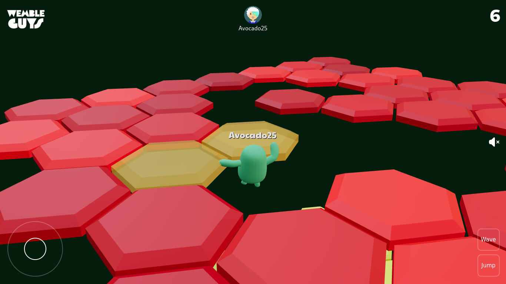
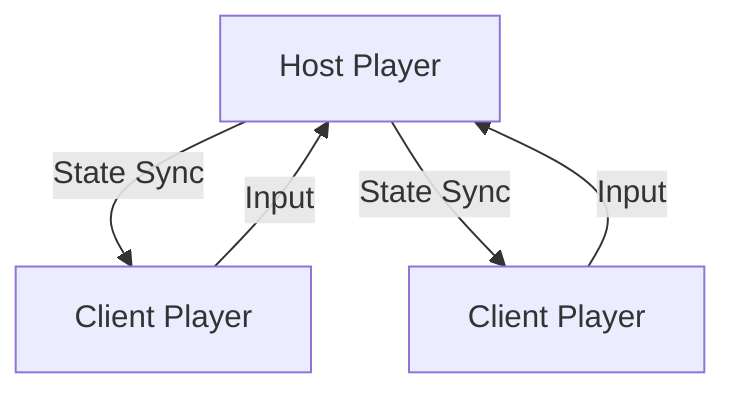
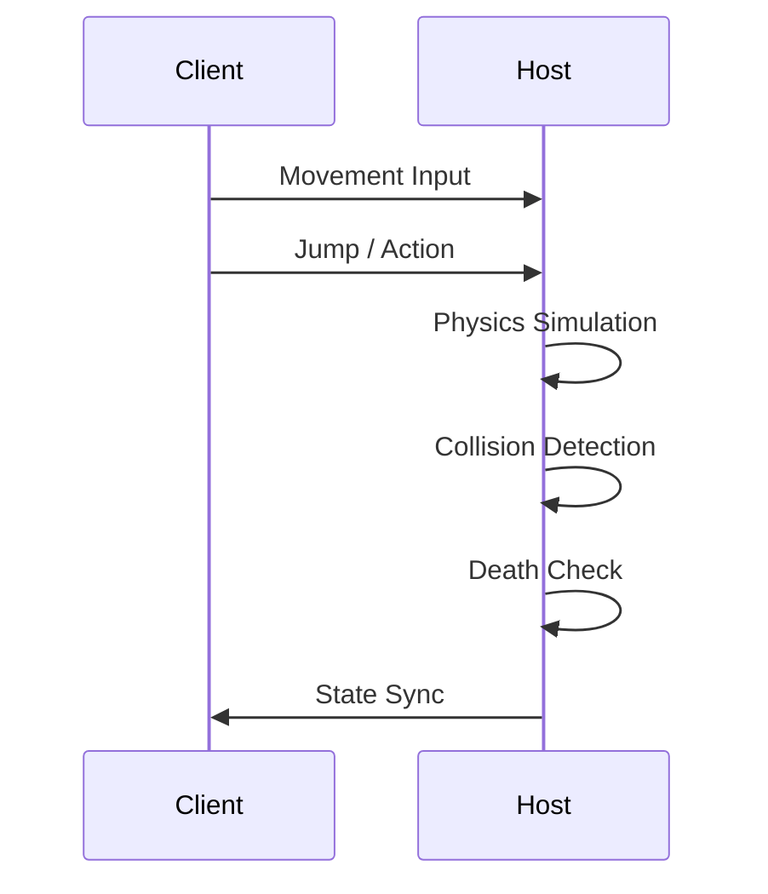

<h1>
  
Wemble Guys
</h1>
> A fast-paced **browser-based 3D multiplayer party game** inspired by Fall Guys–style arenas, built entirely with **React, Three.js, and WebGL**, running **serverless peer-to-peer multiplayer**.

Wemble Guys is a real-time, physics-driven multiplayer playground where players control animated characters, jump across collapsing hex tiles, and compete in short, chaotic rounds — all inside the browser.

---

## 📸 Preview / Thumbnail



---

## Badges


[](./LICENSE)

---

## 🧠 What This Project Is

- 🎮 Real-time multiplayer 3D game
- 🌐 Runs fully in the browser
- 🔗 Peer-to-peer networking (no backend server)
- 🧱 Physics-based gameplay
- 🕹 Keyboard + joystick support
- 🎨 Animated GLTF characters with name tags

### Designed as:

- A WebGL / R3F reference project
- A multiplayer architecture experiment
- A gameplay prototype

---

## 🛠 Tech Stack

### Core

- React 19
- TypeScript
- Vite
- Three.js
- @react-three/fiber
- @react-three/drei
- @react-three/postprocessing

### Physics

- Rapier Physics
- @react-three/rapier

### Multiplayer

- playroomkit
- Peer-to-peer networking
- Host-authoritative state sync
- Player profiles & inputs

### Assets & Styling

- Tailwind CSS
- GLTF / GLB models (Draco + Meshopt compressed)
- HDR environment lighting
- MP3 sound effects & background audio

---

## 🧩 Architecture Overview

Wemble Guys uses a **host-authoritative peer-to-peer model**:

- First player becomes the host
- Host simulates:
  - Physics
  - Player movement
  - Death logic
- Other players:
  - Send input
  - Receive synced transforms & animations



---

## 🗂 Project Structure

```file
src/
├── App.tsx
├── main.tsx
├── assets/
│   ├── audios/
│   ├── fonts/
│   ├── hdrs/
│   ├── images/
│   └── models/
├── components/
│   ├── character.tsx
│   ├── character-controller.tsx
│   ├── experience.tsx
│   ├── game-arena.tsx
│   ├── hexagon.tsx
│   ├── podium.tsx
│   └── ui.tsx
├── constants/
├── hooks/
└── index.css
```

## 🧱 Core Modules

### `Character`

- GLTF-based animated character
- Supports:
  - Multiple animations
  - Dynamic color skins
  - Floating player name text

- Optimized using:
  - Draco compression
  - Meshopt decoder
  - Skeleton cloning

### `CharacterController`

- Player physics & movement
- Jump & fall detection
- Animation state machine
- Camera follow logic
- Death detection & respawn
- Network sync (pos / rot / animation)

### `Experience` **(Game Orchestrator)**

- Multiplayer session lifecycle
- Stage handling (lobby → game → podium)
- Arena spawning
- Audio triggers
- Global game rules

---

## 🔁 Gameplay Loop



---

## 🎮 Controls

- **Move**: Keyboard / Joystick
- **Jump**: Space / Jump button
- **Wave**: Action key
- **Camera**: Auto-follow third-person

---

## 🚀 Getting Started

## Setup & Installation

### Prerequisites

- Node.js ≥ 18
- npm

### Install

```bash
npm install
```

### Run (Development)

```bash
npm run dev
```

Open:

```url
http://localhost:5173
```

### Build

```bash
npm run build
```

### Preview Production Build

```bash
npm run preview
```

---

## 🌐 Multiplayer Notes

- First player becomes the host
- Host controls:
  - Physics
  - Player death
- If host disconnects → session resets

---

## ⚠️ Limitations

- No dedicated server
- No anti-cheat
- Small lobbies only
- Experimental networking
- Browser performance dependent

---

## License

This project is licensed under the **MIT License**. See the [](./LICENSE) for details.
